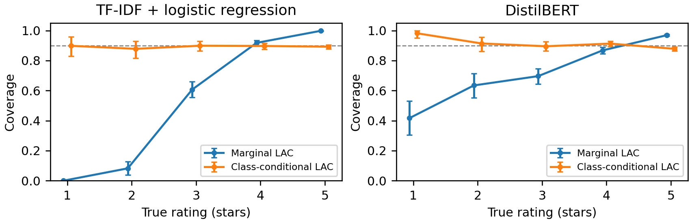
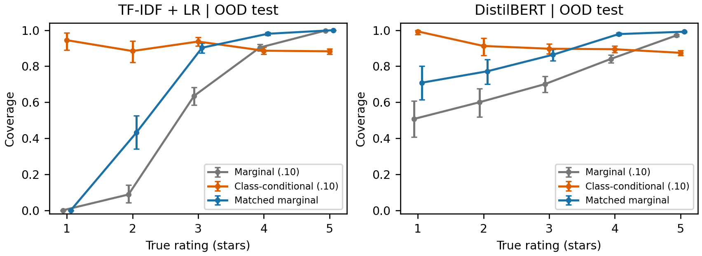

# CalibShift-NLP: An Empirical Study of Class-Conditional Conformal Prediction under Reviewer Distribution Shift

## Abstract

This study examines whether aggregate uncertainty metrics conceal failures on minority ratings in text classification under reviewer distribution shift. We reuse a three-seed experiment on the official WILDS Amazon task, comparing TF-IDF logistic regression (LR) and DistilBERT with temperature scaling. Marginal least-ambiguous classification (LAC) is compared with established label-conditional, or Mondrian, LAC on fixed samples. On the primary out-of-distribution (OOD) validation set, one-star coverage increases from 0.0% to 89.8% for LR and from 41.7% to 98.1% for DistilBERT. Mean prediction sets increase by 0.407 and 0.559 labels, respectively. Reviewer-cluster bootstrap intervals support a large conditional improvement for these fitted models, but rare-class calibration counts and prior test exposure limit interpretation. We do not establish exchangeability under shift or introduce a new algorithm. The contribution is an audited empirical account of classwise reliability and its efficiency cost.

## 1. Introduction

A review classifier can perform reasonably on its dominant rating while providing poor uncertainty sets for infrequent negative reviews. Accuracy summarizes a single predicted label; marginal conformal coverage summarizes whether a set contains the true rating after averaging over the rating distribution. Neither directly describes reliability for each rating. When five-star reviews dominate, high aggregate coverage can coexist with severe undercoverage of one-star reviews.

Reviewer shift adds a second distinction. A classifier and its calibration rule may be evaluated on reviews written by people outside the training domain. Even if aggregate ID and OOD coverage appear similar, class-specific score distributions can change. Conversely, an observed OOD deficit is not itself evidence of a statistically stable population difference. This project separates empirical comparisons from the assumptions required for theoretical coverage.

The questions are: how do the two classifiers compare beyond accuracy; does marginal LAC conceal minority-rating failures; and how much larger must prediction sets become when calibration is stratified by rating? The study uses fixed models and evaluation rows. Its scope is implementation correctness, descriptive replication and dependence-aware uncertainty, rather than new conformal theory, model selection on test data, or a claim of benchmark-leading performance.

## 2. Related Work

WILDS provides real distribution-shift tasks and official splits; its Amazon task uses review ratings and reviewer domains [1]. DistilBERT supplies a compact pretrained language encoder [2]. These resources motivate a feasible comparison with a sparse text baseline. Temperature scaling is an established post-hoc probability calibration method [3]. It modifies confidence without changing the predicted class when the temperature is positive.

Conformal prediction converts scores into sets using calibration order statistics [4]. Label-Mondrian prediction partitions calibration examples by label [5]. We apply these existing methods, without claiming algorithmic novelty. Work beyond exchangeability emphasizes that distribution drift and dependence require explicit treatment rather than automatic inheritance of standard validity [6]. Cluster bootstrap theory likewise depends on how clusters arise and the target of inference [7]; resampling reviewers is an approximate inferential choice, not a universal correction for dependence.

<!-- PDF page break -->

## 3. Methodology

### 3.1 Fixed classifiers and temperature scaling

The task has labels y in {0,1,2,3,4}, corresponding exactly to ratings of one through five stars. LR uses unigram/bigram TF-IDF features, sublinear term frequency, at most 30,000 features, C=1, and a maximum of 1,000 solver iterations. DistilBERT-base-uncased is fine-tuned for five classes from a fixed pretrained revision. Its text is truncated to 128 tokens; LR uses complete text. Consequently, the comparison includes preprocessing differences as well as model-family differences.

For logits z(x), p_T(k|x)=exp(z_k/T)/sum_j exp(z_j/T). A positive scalar T is fitted by minimizing multiclass negative log-likelihood on the temperature subset alone, using a bounded search over log T in [-5,5]. The unscaled model uses T=1. Temperature and conformal rows are distinct. Stage 3 reuses the previously fitted temperatures and model weights; it does not optimize a new model or threshold on validation/test outcomes.

### 3.2 Marginal LAC and finite-sample correction

For each conformal calibration row i, the nonconformity score is s_i=1-p_T(y_i|x_i). Let n be the calibration size and alpha=0.1. Define r=ceil((n+1)(1-alpha)). If r<=n, q is the r-th smallest calibration score; otherwise q=+infinity. The prediction set is C(x)={k:1-p_T(k|x)<=q}. The inequality includes ties. Empty sets are allowed; no top-1 repair is applied. The infinite threshold is equivalent to augmenting the score list with +infinity rather than incorrectly clipping the rank to n.

### 3.3 Class-conditional LAC

For rating k, retain only calibration rows whose true label equals k, giving n_k scores and rank r_k=ceil((n_k+1)(1-alpha)). Compute q_k by the same augmented order-statistic rule. The new set is C_cc(x)={k:1-p_T(k|x)<=q_k}. At prediction time every candidate label is evaluated against its own threshold; the unknown true label is never used to construct the set. Stratifying by predicted labels would be a different procedure and is not implemented here.

When n_k=0 or r_k>n_k, q_k=+infinity and candidate k is always included. At this target, classes with fewer than nine calibration rows receive this conservative treatment. There is no silent fallback to a global threshold. The observed experiments have finite class thresholds, but this edge case is explicitly tested. Conditional validity, when applicable, is marginal over calibration and future data within a label; it is not certainty for one fixed calibration set or a simultaneous confidence statement for all ratings.

### 3.4 Metrics and reviewer-cluster inference

We report accuracy, fixed-five-class Macro-F1, natural-log NLL, top-label ECE using 15 equal-width bins, and the multiclass Brier score (sum of squared errors over classes). Set metrics are overall coverage, coverage and mean set size by true rating, overall mean size, worst-class coverage, and equal-weight macro class coverage. Worst-class coverage is computed within each seed before averaging. It need not equal the minimum of the seed-averaged class coverages.

We resample the observed reviewer clusters with replacement 2,000 times, retaining every observed review of a sampled reviewer with its cluster multiplicity. Overall metrics remain review-weighted ratios. Two methods use identical resampling weights within a split; ID and OOD use independent streams. Percentile bounds are the 2.5th and 97.5th percentiles. Shared evaluation rows across seeds also use common cluster weights, and bootstrap statistics are averaged across the three fixed fitted models. These intervals condition on models, temperatures and thresholds; they omit refitting uncertainty and are not confidence intervals for arbitrary future training runs.

<!-- PDF page break -->

## 4. Experimental Setup

The implementation uses WILDS 2.0.1 and Amazon dataset version 2.1 through the official interface. The original train, id_val, id_test, val and test roles are retained. Formal runs use 10,000 training rows; id_val supplies disjoint temperature and conformal subsets of 2,000 rows each. Every evaluation split contains 3,000 reviews. Seeds 42, 123 and 2026 change training/calibration sampling, initialization and training order; they therefore do not isolate optimization randomness.

A preceding 3,000-row run checked pipeline stability using OOD validation only. Formal hyperparameters remained fixed. DistilBERT uses two epochs, batch size four, gradient accumulation over four steps, AdamW learning rate 2e-5, weight decay 0.01, gradient clipping at 1.0, GPU FP16 and gradient checkpointing. Runs completed on Windows 11, Python 3.12.10 and an RTX 3070 with 8 GB, using PyTorch 2.7.1+cu126 and Transformers 4.53.2. No model was retrained for this report.

Table 1. Actual training and calibration counts by true rating.

| Seed | Subset | 1 star | 2 stars | 3 stars | 4 stars | 5 stars |
| --- | --- | --- | --- | --- | --- | --- |
| 42 | Train | 108 | 257 | 912 | 2883 | 5840 |
| 42 | Temp. | 20 | 59 | 180 | 534 | 1207 |
| 42 | Conformal | 32 | 64 | 178 | 613 | 1113 |
| 123 | Train | 107 | 278 | 935 | 2978 | 5702 |
| 123 | Temp. | 20 | 62 | 176 | 545 | 1197 |
| 123 | Conformal | 24 | 55 | 172 | 541 | 1208 |
| 2026 | Train | 102 | 282 | 941 | 2964 | 5711 |
| 2026 | Temp. | 22 | 54 | 165 | 563 | 1196 |
| 2026 | Conformal | 26 | 52 | 204 | 539 | 1179 |

Table 2. Evaluation counts, shared exactly across all seeds.

| Fixed evaluation set | 1 star | 2 stars | 3 stars | 4 stars | 5 stars |
| --- | --- | --- | --- | --- | --- |
| ID test | 26 | 70 | 304 | 878 | 1722 |
| OOD validation | 36 | 93 | 280 | 804 | 1787 |
| OOD test | 48 | 95 | 301 | 848 | 1708 |

Each within-run row index is unique across train, calibration and evaluation. Reviewer identifiers are retained and checked against their encoded metadata. OOD reviewers do not overlap the training/calibration domain. ID reviewer-domain overlap follows the official design. Temperature and conformal subsets are row-disjoint but share reviewers, so row separation alone does not establish statistical independence or exchangeability.

Earlier stages had already examined ID/OOD test predictions. Stage 2 excluded the previously observed 350 rows from each final test subset, but fresh rows from the same benchmark do not erase prior distribution-level exposure. Stage 3 reuses those fixed test subsets and designates OOD validation as primary. Since validation and test distributions have both been examined during the project, all results are exploratory rather than a completely independent confirmatory validation. Each fixed test split has 3,000 unique reviews, not 9,000 independent observations.

<!-- PDF page break -->

## 5. Results

### 5.1 Classification and probability calibration

Table 3. Temperature-scaled probability metrics, mean across three fitted runs.

| Model | Split | Accuracy | Macro-F1 | NLL | ECE | Brier |
| --- | --- | --- | --- | --- | --- | --- |
| LR | ID | 0.6420 | 0.2876 | 0.8389 | 0.0242 | 0.4695 |
| LR | OOD | 0.6284 | 0.2811 | 0.8696 | 0.0420 | 0.4797 |
| DistilBERT | ID | 0.6506 | 0.4103 | 0.8001 | 0.0270 | 0.4568 |
| DistilBERT | OOD | 0.6378 | 0.4016 | 0.8195 | 0.0404 | 0.4672 |

DistilBERT improves OOD Macro-F1 relative to LR: 0.4016 versus 0.2811. The paired mean OOD Macro-F1 difference is 0.1205 (95% cluster CI 0.0971 to 0.1455). The OOD accuracy difference is 0.0093 (CI -0.0020 to 0.0223), which crosses zero. This is evidence of different class-balanced behavior, not a stable accuracy advantage on every seed.

The train-determined majority class is five stars. Its fixed ID/OOD test accuracy is 0.5740/0.5693. Both trained methods exceed this descriptive reference, but the majority benchmark illustrates why accuracy alone is insufficient.

Table 4. OOD test probability calibration before and after temperature scaling.

| Model | Probability | OOD NLL | OOD ECE | OOD Brier |
| --- | --- | --- | --- | --- |
| LR | raw | 0.8693 | 0.0359 | 0.4778 |
| LR | temperature | 0.8696 | 0.0420 | 0.4797 |
| DistilBERT | raw | 0.8405 | 0.0829 | 0.4776 |
| DistilBERT | temperature | 0.8195 | 0.0404 | 0.4672 |

### 5.2 Primary comparison on OOD validation

Table 5. Primary validation set: coverage proportions and mean set size.

| Model | LAC | Overall | 1-star | Set size | Worst | Macro |
| --- | --- | --- | --- | --- | --- | --- |
| LR | Marginal | 0.8999 | 0.0000 | 1.8807 | 0.0000 | 0.5212 |
| LR | Class-cond. | 0.8939 | 0.8981 | 2.2880 | 0.8420 | 0.8929 |
| DistilBERT | Marginal | 0.8996 | 0.4167 | 1.7839 | 0.4143 | 0.7169 |
| DistilBERT | Class-cond. | 0.8914 | 0.9815 | 2.3433 | 0.8731 | 0.9164 |

For LR, one-star coverage rises to 0.8981 with CI 0.8301 to 0.9584. For DistilBERT it rises to 0.9815 with CI 0.9510 to 1.0000. These are conditional evaluation intervals for the observed fitted models. A high observed minority-class value is not proof of its exact population coverage.

<!-- PDF page break -->

### 5.3 Classwise reliability and the efficiency cost

The principal pattern is redistribution across ratings. Marginal LAC covers the dominant rating well while failing on low ratings, especially for LR. Classwise thresholds raise minority inclusion, while the threshold for a frequent rating may become stricter. Thus the new set is not necessarily a superset of the marginal set. A larger mean set can coexist with a slightly lower overall coverage.

The paired one-star validation improvement is 89.8 percentage points for LR (CI 83.0 to 95.8) and 56.5 points for DistilBERT (CI 45.8 to 67.4). Mean set size increases by 0.407 labels (CI 0.373 to 0.440) and 0.559 labels (CI 0.533 to 0.587), respectively. Intervals use paired cluster draws rather than subtraction of separate interval endpoints.

### 5.4 Exploratory ID/OOD test comparisons

Table 6. Minority improvement and set sizes on previously examined test splits.

| Model | Split | 1-star M | 1-star CC | Size M | Size CC |
| --- | --- | --- | --- | --- | --- |
| LR | ID | 0.0000 | 0.8846 | 1.9180 | 2.3376 |
| LR | OOD | 0.0000 | 0.9444 | 1.9066 | 2.3529 |
| DistilBERT | ID | 0.4231 | 0.9359 | 1.8094 | 2.3832 |
| DistilBERT | OOD | 0.5069 | 0.9931 | 1.8014 | 2.3680 |

The direction of the one-star improvement is consistent across the primary and secondary splits, but achieved coverage levels differ. Marginal OOD-minus-ID overall coverage differences average -1.24 percentage points for LR (CI -2.98 to 0.35) and -0.84 for DistilBERT (CI -2.22 to 0.62). Both intervals cross zero. The experiment does not establish a stable overall coverage decline under shift, despite negative point differences in all three runs.

The minority-class gain does not establish that every rating attains its target under OOD shift. The full per-rating tables and true-rating set sizes remain in class_coverage.csv. A very large set for a rare negative review may be a practical cost even when the global average looks modest; the aggregate efficiency summary should therefore be read together with rating-specific sizes.

<!-- PDF page break -->

### 5.5 Matched-Size Coverage-Efficiency Analysis

A fixed supplementary contrast asks whether minority gains persist at similar mean set size. For each fitted seed, class-conditional LAC stays at alpha=0.10. Marginal LAC searches all attainable calibration-score thresholds plus infinity, selecting the threshold whose OOD validation inclusion count is closest to that target. Only validation probabilities and set sizes enter selection, not validation labels or any test outcome. Ties prefer the smaller inclusion count, then the smaller threshold. A rank-interval midpoint supplies a reproducible alpha. The chosen rule is fixed before test comparison.

Table 7. OOD test, three-seed means. Near size matching does not equalize nominal targets.

| Model | Method | Mean size | 1-star (%) | Worst (%) | Overall (%) |
| --- | --- | --- | --- | --- | --- |
| LR | Class-cond. | 2.353 | 94.44 | 87.26 | 89.01 |
| LR | Matched M | 2.339 | 0.00 | 0.00 | 95.06 |
| DistilBERT | Class-cond. | 2.368 | 99.31 | 87.43 | 88.53 |
| DistilBERT | Matched M | 2.364 | 70.83 | 69.04 | 96.36 |

At nearly matched size, DistilBERT one-star coverage is 99.31% versus 70.83%, and worst-class coverage is 87.43% versus 69.04%. Paired differences are 28.47 percentage points (95% CI 19.33 to 37.78) and 18.39 points (CI 11.56 to 26.49). LR also retains a large one-star contrast: 94.44 points (CI 88.89 to 98.58).

This is a redistribution of coverage, not a free improvement. DistilBERT overall coverage is 88.53% versus 96.36%; class-conditional coverage is lower by 8.41 and 11.73 points on four- and five-star reviews. Its overall paired difference is -7.82 points (CI -8.83 to -6.90). It therefore does not dominate matched marginal LAC on all reliability objectives.

No validation match is exact because thresholds are discrete, and test means can differ further. Matched marginal alpha differs from 0.10, so nominal targets are unequal; selection does not confer a new guarantee. Test data were previously explored and one-star test support is limited. Paired cluster intervals preserve shared comments across seeds but condition on the fitted models, calibration rules and selected alpha, omitting training, calibration-refitting and matching-selection uncertainty. The contrast is exploratory, not independent confirmation or a theorem of shifted-data validity.

<!-- PDF page break -->

## 6. Discussion and Limitations

### 6.1 What the rare-class evidence supports

One-star training counts are only 102 to 108 per run. Conformal counts are 24 to 32. The primary one-star evaluation contains 36 reviews from 32 reviewers; the ID/OOD test subsets contain 26/48 such reviews. This supports observation of a large fitted-method contrast but not highly precise population estimates. Classwise tail quantiles are determined by few calibration examples, and their fitting uncertainty is absent from the reported evaluation intervals.

For LR marginal one-star coverage, no observed success is available to resample. The nonparametric bootstrap consequently returns a degenerate [0,0] interval. This is a limitation of the empirical resampling distribution, not evidence that the population parameter is known to be zero. No independent-review binomial interval is substituted, because that would ignore reviewer dependence. The report states the zero count and sample support explicitly and avoids a population-certainty interpretation.

### 6.2 Reviewer dependence and the inferential target

The fixed ID test set contains 623 reviewers, and OOD test contains 1200. OOD test has median 2 reviews per reviewer; 92.2% have fewer than five observed reviews. These samples cannot support precise claims about each individual reviewer. Reviewer-level coverage summaries are descriptive, whereas cluster resampling accounts approximately for within-reviewer dependence when estimating aggregate or rating-specific metrics.

The bootstrap assumes approximately independent, representative reviewer clusters. Sampling was uniform over reviews, not balanced over reviewers, and cluster sizes vary. Accordingly, intervals are approximate superpopulation summaries conditional on the observed design, not exact finite-population survey intervals. Shared products or time effects can correlate different reviewers. Class conditionality, P(Y in C(X) | Y=k), is also distinct from reviewer conditionality, P(Y in C(X) | reviewer=u). Improving one does not guarantee the other.

### 6.3 Why validity cannot be inferred from observed coverage

A standard class-conditional conformal guarantee requires calibration and future observations to be exchangeable within each class for the fitted scoring rule. Reviewer shift may alter text and score distributions even after conditioning on rating. ID labels alone do not prove exchangeability. Row-disjoint temperature and conformal subsets still share reviewers, further limiting an independence argument. Reviewer bootstrap intervals do not repair these calibration assumptions. Neither proximity to the target nor an interval excluding a deficit constitutes a theoretical guarantee under OOD shift.

The same evaluation comments are reused across seeds, and seed variation mixes training sample, calibration sample and optimization changes. Three runs are not a broad characterization of training variability. All intervals are pointwise, exploratory and unadjusted for multiple comparisons. Worst-class minima are nonsmooth statistics and their bootstrap behavior near ties needs caution. Previous test exposure, the finite benchmark, class imbalance, a single shift type, token truncation and unequal preprocessing constrain generalization. None of these limitations is removed by more decimal places in a results table.

<!-- PDF page break -->

## 7. Conclusion

The completed project provides a reproducible and audited comparison of established calibration and conformal methods on an official reviewer-shift task. Its empirical contribution is to show that acceptable-looking marginal coverage can conceal severe minority-rating failures, and to measure how labelwise calibration redistributes coverage at an observable prediction-set cost. DistilBERT offers better class-balanced prediction than the sparse baseline in these runs, while its accuracy advantage and an overall ID/OOD coverage decline remain uncertain under paired cluster analysis.

The evidence supports an empirical minority-reliability trade-off for fixed fitted models, not a new algorithm or an OOD validity theorem. The matched-size contrast further identifies a minority/frequent-rating allocation trade-off rather than uniform performance improvement. The final audit found no numerical discrepancy requiring experimental results to be changed. It verified label mapping, per-class counts, repeated evaluation rows, reviewer-cluster resampling, augmented finite-sample quantiles and row-level split separation. Existing results and model weights were retained. These boundaries are part of the contribution: the report distinguishes what the measurements show from what the design and theory can justify.

## References

[1] Koh, P. W., et al. (2021). WILDS: A Benchmark of in-the-Wild Distribution Shifts. Proceedings of ICML, PMLR 139, 5637-5664. [https://proceedings.mlr.press/v139/koh21a.html](https://proceedings.mlr.press/v139/koh21a.html)

[2] Sanh, V., Debut, L., Chaumond, J., and Wolf, T. (2019). DistilBERT, a distilled version of BERT: smaller, faster, cheaper and lighter. arXiv:1910.01108. [https://arxiv.org/abs/1910.01108](https://arxiv.org/abs/1910.01108)

[3] Guo, C., Pleiss, G., Sun, Y., and Weinberger, K. Q. (2017). On Calibration of Modern Neural Networks. Proceedings of ICML, PMLR 70, 1321-1330. [https://proceedings.mlr.press/v70/guo17a.html](https://proceedings.mlr.press/v70/guo17a.html)

[4] Angelopoulos, A. N., and Bates, S. (2023). Conformal Prediction: A Gentle Introduction. Foundations and Trends in Machine Learning, 16(4), 494-591. DOI: 10.1561/2200000101. [https://doi.org/10.1561/2200000101](https://doi.org/10.1561/2200000101)

[5] On-line Prediction Wiki. Mondrian Conformal Predictor. Technical definition and label-conditional example; accessed 12 November 2026. [https://op.cs.rhul.ac.uk/pmwiki.php?n=Main.MondrianConformalPredictor](https://op.cs.rhul.ac.uk/pmwiki.php?n=Main.MondrianConformalPredictor)

[6] Barber, R. F., Candes, E. J., Ramdas, A., and Tibshirani, R. J. (2023). Conformal prediction beyond exchangeability. The Annals of Statistics, 51(2), 816-845. DOI: 10.1214/23-AOS2276. [https://doi.org/10.1214/23-AOS2276](https://doi.org/10.1214/23-AOS2276)

[7] Field, C. A., and Welsh, A. H. (2007). Bootstrapping clustered data. Journal of the Royal Statistical Society: Series B, 69(3), 369-390. DOI: 10.1111/j.1467-9868.2007.00593.x. [https://doi.org/10.1111/j.1467-9868.2007.00593.x](https://doi.org/10.1111/j.1467-9868.2007.00593.x)

### Artifact and audit notes

The repository README gives environment and reproduction commands. The final results summary links primary CSVs and states the inferential caveats. results/final_audit/ contains the sample-count audit, numerical provenance and final test log for the original study; results/report_update/ records the supplemental report validation and 19-test check. The report was generated directly from saved CSV cells; probabilities and prediction sets were checked against the original artifacts. No new statistical method, training run or evaluation split was introduced during this finalization.
