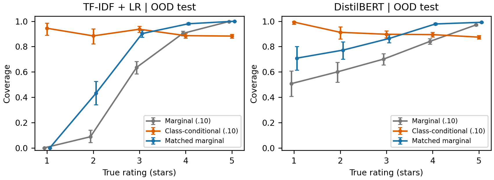

# Final Results Summary

All results are from completed experiments. No retraining, new split or new statistical method was used for finalization.

## Audit

- Labels 0-4 map to ratings 1-5. Reviewer IDs and per-class counts agree with saved manifests.
- Each evaluation split contains 3,000 shared unique comments across seeds, not 9,000 independent observations.
- Reviewer-cluster resampling and finite-sample class quantiles were verified.
- Zero-event [0,0] bootstrap intervals do not establish zero population coverage.
- Temperature/conformal rows are distinct but share reviewers; OOD validity is not established.
- The original 16 tests and 3 matched-size tests pass; existing experiment artifacts and weights are unchanged.

## Primary OOD validation comparison

Values are three-seed means after temperature scaling; CI is conditional on fitted models and calibration rules.

| Model | Method | Overall coverage | One-star coverage (95% CI) | Set size | Worst-class | Macro class |
|---|---|---:|---|---:|---:|---:|
| LR | marginal | 0.8999 | 0.0000 [0.0000 to 0.0000] | 1.8807 | 0.0000 | 0.5212 |
| LR | class_conditional | 0.8939 | 0.8981 [0.8301 to 0.9584] | 2.2880 | 0.8420 | 0.8929 |
| DistilBERT | marginal | 0.8996 | 0.4167 [0.3043 to 0.5299] | 1.7839 | 0.4143 | 0.7169 |
| DistilBERT | class_conditional | 0.8914 | 0.9815 [0.9510 to 1.0000] | 2.3433 | 0.8731 | 0.9164 |

The LR zero-event interval is degenerate and is not a valid claim of population certainty. Class-conditional sets redistribute coverage and are not necessarily supersets of marginal sets.

## Evidence and limits

LR/BERT validation set-size increases: 0.407/0.559 labels. One-star calibration counts are 32/24/26 for seeds 42/123/2026; fixed ID/validation/OOD test counts are 26/36/48. Large observed improvements do not make these rare-class estimates precise.

Marginal OOD-minus-ID coverage differences: LR -1.24 percentage points [-2.98, 0.35]; DistilBERT -0.84 [-2.22, 0.62]. Both conditional intervals cross zero.

DistilBERT improves Macro-F1 in the paired comparison; an accuracy advantage is not established. Reviewer-level conditional coverage is not guaranteed. Previous test exposure makes the study exploratory. The contribution is a reproducible empirical characterization of an existing-method trade-off, with explicit statistical limitations.

## Files

- [English report (PDF)](FINAL_RESEARCH_REPORT.pdf) and [Markdown](FINAL_RESEARCH_REPORT.md).
- [Classwise counts, coverage and size](results/stage3/class_coverage.csv).
- [Seed-averaged comparison and intervals](results/stage3/class_conditional_comparison.csv).
- [Paired method changes](results/stage3/mean_method_difference.csv).
- [Classifier metrics](results/stage2/multiseed_metrics.csv).
- [Final audit](results/final_audit/FINAL_STATISTICAL_AUDIT.json) and [verified counts](results/final_audit/verified_sample_counts.csv).

## Matched-size supplementary results

The supplementary comparison selects marginal LAC's alpha using **validation probabilities and set sizes only**, then fixes that rule on the previously examined OOD test. Class-conditional LAC stays at alpha=0.10. The discrete threshold search gives near, not exact, size matching.

| Model | Method | Mean set size | One-star coverage | Worst-class coverage | Overall coverage |
|---|---|---:|---:|---:|---:|
| LR | Class-Conditional | 2.353 | 94.44% | 87.26% | 89.01% |
| LR | Matched Marginal | 2.339 | 0.00% | 0.00% | 95.06% |
| DistilBERT | Class-Conditional | 2.368 | 99.31% | 87.43% | 88.53% |
| DistilBERT | Matched Marginal | 2.364 | 70.83% | 69.04% | 96.36% |

For DistilBERT, the paired one-star difference is **+28.47 percentage points** (conditional 95% reviewer-cluster CI [19.33, 37.78]); the worst-class difference is +18.39 points [11.56, 26.49].

This is an improvement in **coverage allocation across ratings**, not a cost-free gain in every metric: DistilBERT overall coverage is 88.53% versus 96.36%, while four- and five-star coverage fall by 8.41 and 11.73 points. The two methods have different alpha/nominal targets; there is no new OOD coverage guarantee. Rare-class support is limited, test use is exploratory, and intervals omit full training, calibration-refitting and validation-selection uncertainty. Shared comments are not treated as independent datasets across seeds.

[Supplementary report](results/matched_size/MATCHED_SIZE_REPORT.md) · [Per-seed metrics](results/matched_size/matched_size_metrics.csv) · [Paired intervals](results/matched_size/paired_differences.csv) · [Selected alpha and size gaps](results/matched_size/matching_choices.csv)
