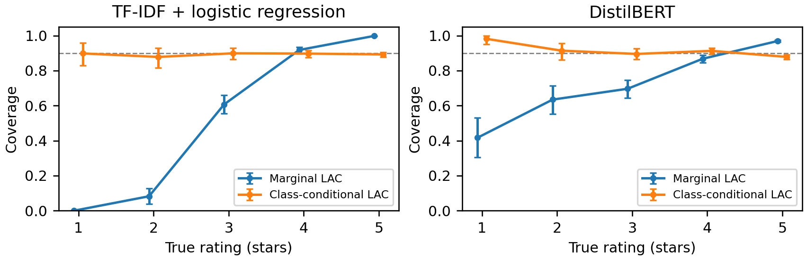
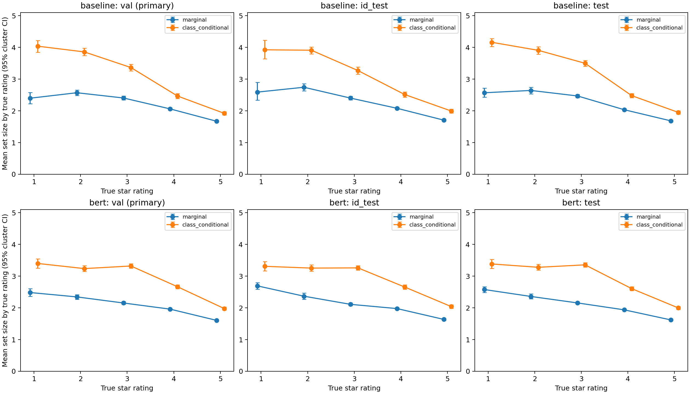

# CalibShift-NLP

**Independent Research Project**

## Overview

CalibShift-NLP is an empirical study of statistical calibration and class-conditional conformal prediction for text classification under reviewer distribution shift. It predicts one-to-five-star Amazon review ratings and examines the reliability of prediction sets under class imbalance.

The project implements and evaluates established methods. Its contribution is a reproducible empirical analysis with an explicit statistical audit, rather than a new algorithm or a published research paper.

## Research Questions

1. Can overall prediction-set coverage conceal failures on rare ratings?
2. How do a sparse text classifier and a pretrained language model compare in accuracy, Macro-F1 and probability calibration?
3. How much does prediction-set size increase when calibration is conditioned on rating?

## Methods

- **TF-IDF + Logistic Regression:** unigram/bigram features, up to 30,000 features, multinomial classification.
- **DistilBERT-base-uncased:** five-class fine-tuning, 128-token truncation, two epochs.
- **Temperature Scaling:** a positive scalar fitted on a dedicated subset, separate from conformal calibration.
- **Marginal LAC:** one threshold for scores `1 - p(true label)`.
- **Class-Conditional LAC:** a separate threshold for each true calibration label; all candidate labels are evaluated at prediction time.

Both conformal methods use the finite-sample rank `ceil((n + 1) * (1 - alpha))` with `alpha = 0.1`. If a class is missing or has insufficient calibration observations, its threshold is positive infinity and that candidate is always included. There is no fallback to a global threshold.

Uncertainty is summarized with 2,000 reviewer-cluster bootstrap replicates. Reviewers are resampled with all their observed comments; method comparisons share the same cluster weights.

## Dataset

The study uses [Amazon Reviews from WILDS](https://wilds.stanford.edu/datasets/) and the [official WILDS loader](https://github.com/p-lambda/wilds/blob/main/wilds/datasets/amazon_dataset.py), package version 2.0.1 and dataset version 2.1. Data and pretrained weights must be obtained separately; neither is redistributed in this repository. The original data source requests research use.

| Official split | Formal sample per seed | Purpose |
|---|---:|---|
| train | 10,000 | Model fitting |
| id_val | 4,000 | 2,000 temperature + 2,000 conformal calibration rows |
| val | 3,000 | OOD development; primary class-conditional comparison |
| id_test | 3,000 | Exploratory ID evaluation |
| test | 3,000 | Exploratory OOD evaluation |

Seeds are **42, 123 and 2026**. Evaluation comments are identical across seeds: each split contains 3,000 unique comments, not 9,000 independent observations. Encoded labels 0-4 correspond to one-to-five stars.

## Key Findings

The primary OOD validation comparison uses temperature-scaled probabilities and reports the mean of the three fitted runs:

| Model | LAC method | One-star coverage | Average prediction-set size |
|---|---|---:|---:|
| TF-IDF + LR | Marginal | 0.00% | 1.881 |
| TF-IDF + LR | Class-Conditional | 89.81% | 2.288 |
| DistilBERT | Marginal | 41.67% | 1.784 |
| DistilBERT | Class-Conditional | 98.15% | 2.343 |

Minority-rating coverage improves, at a cost in set size. Class-conditional sets are not necessarily supersets of marginal sets, so overall coverage need not increase. DistilBERT improves Macro-F1 in the paired comparison; its average accuracy advantage is not established by the conditional cluster intervals.

**These are empirical results, not new theoretical guarantees.** One-star calibration counts are only 32/24/26 across the seeds; the primary validation set has 36 one-star comments. Conformal coverage guarantees do not automatically hold under OOD shift.

## Reproduction

Tested environment: Windows 11, Python 3.12.10, RTX 3070 8 GB, PyTorch 2.7.1+cu126, Transformers 4.53.2. Dependencies are pinned in [requirements.txt](requirements.txt); the recorded environment is in [requirements-lock-windows.txt](requirements-lock-windows.txt).

From the repository root in PowerShell:

```powershell
python -m venv .venv
$py = ".\.venv\Scripts\python.exe"
& $py -m pip install torch==2.7.1 torchvision==0.22.1 --index-url https://download.pytorch.org/whl/cu126
& $py -m pip install -r requirements.txt
& $py -m pip check
& $py -m pytest -q
```

The following entry points were executed in the completed study. They reproduce training when local artifacts are absent; no retraining was performed for publication:

```powershell
# CPU smoke downloads missing official WILDS data and pretrained weights.
& $py run.py --mode smoke
# Recreate historical 500-row manifests used to exclude previously seen test rows.
& $py run.py --mode all --config config.small.yaml
& $py stage2.py --mode medium
& $py stage2.py --mode formal
& $py stage2.py --mode analyze
& $py stage3.py --mode all
```

The smoke run uses the official WILDS interface with downloading enabled. Allow disk and memory headroom: the archive is about 1.99 GB and the reviews CSV about 5.50 GB. Stage 2 uses existing local data and offline pretrained caches. Raw manifests, prepared subsets, saved models and prediction caches are excluded from Git and are regenerated by the commands above.

With existing local models/predictions, these executed commands reuse artifacts:

```powershell
& $py run.py --mode evaluate --config results/stage2/configs/formal_seed42.yaml --run-name stage2/formal_seed42
& $py stage2.py --mode analyze
& $py stage3.py --mode audit
& $py stage3.py --mode all
```

Stage 3 does not train models. Its input hashes prevent silent reuse after earlier artifacts change. Saved run signatures contain resolved paths, so existing experiment directories are not transparently portable. Fresh reproduction may differ numerically across hardware even with fixed seeds. The 16 unit/statistical tests pass in the recorded environment.

## Results and Figures





- [Classwise coverage, size, calibration counts and evaluation counts](results/stage3/class_coverage.csv)
- [Class-conditional comparison and conditional confidence intervals](results/stage3/class_conditional_comparison.csv)
- [Paired improvements and set-size costs](results/stage3/mean_method_difference.csv)
- [Three-seed classification metrics](results/stage2/multiseed_metrics.csv)
- [Final results summary](FINAL_RESULTS_SUMMARY.md)

## Research Report

[Read the seven-page English technical report (PDF)](FINAL_RESEARCH_REPORT.pdf), or its [Markdown version](FINAL_RESEARCH_REPORT.md). This is an independent research report, not a published paper.

## Limitations

- Rare ratings have limited training, calibration and evaluation support. Zero observed coverage can yield a degenerate `[0,0]` bootstrap interval; this does not establish zero population coverage.
- Confidence intervals condition on fitted models and calibration thresholds, omit refitting uncertainty and are pointwise without multiplicity adjustment.
- Temperature/conformal rows are disjoint but share reviewers. Reviewer dependence and shared products can violate exchangeability and independence assumptions.
- Class-conditional coverage differs from reviewer-conditional coverage. OOD reviewers usually have too few observed comments for precise individual estimates.
- Earlier stages examined test predictions. Stage 2 excluded the 350 previously seen rows per test split, but benchmark-level exposure remains; the analyses are exploratory.
- Three seeds reuse evaluation comments. LR uses full text while DistilBERT truncates it, so model comparisons include preprocessing differences.

The project demonstrates an observed minority-coverage/set-size trade-off using established methods. It does not establish validity under distribution shift.

## References

- Koh et al. (2021). [WILDS: A Benchmark of in-the-Wild Distribution Shifts](https://proceedings.mlr.press/v139/koh21a.html).
- Sanh et al. (2019). [DistilBERT, a distilled version of BERT](https://arxiv.org/abs/1910.01108).
- Guo et al. (2017). [On Calibration of Modern Neural Networks](https://proceedings.mlr.press/v70/guo17a.html).
- Angelopoulos and Bates (2023). [Conformal Prediction: A Gentle Introduction](https://doi.org/10.1561/2200000101).
- [Mondrian Conformal Predictor](https://op.cs.rhul.ac.uk/pmwiki.php?n=Main.MondrianConformalPredictor), technical definition.
- Field and Welsh (2007). [Bootstrapping clustered data](https://doi.org/10.1111/j.1467-9868.2007.00593.x).
